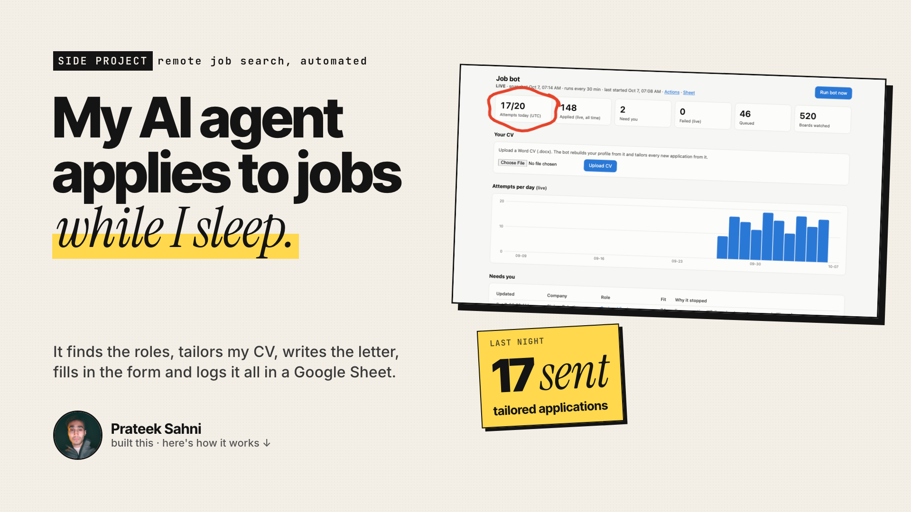
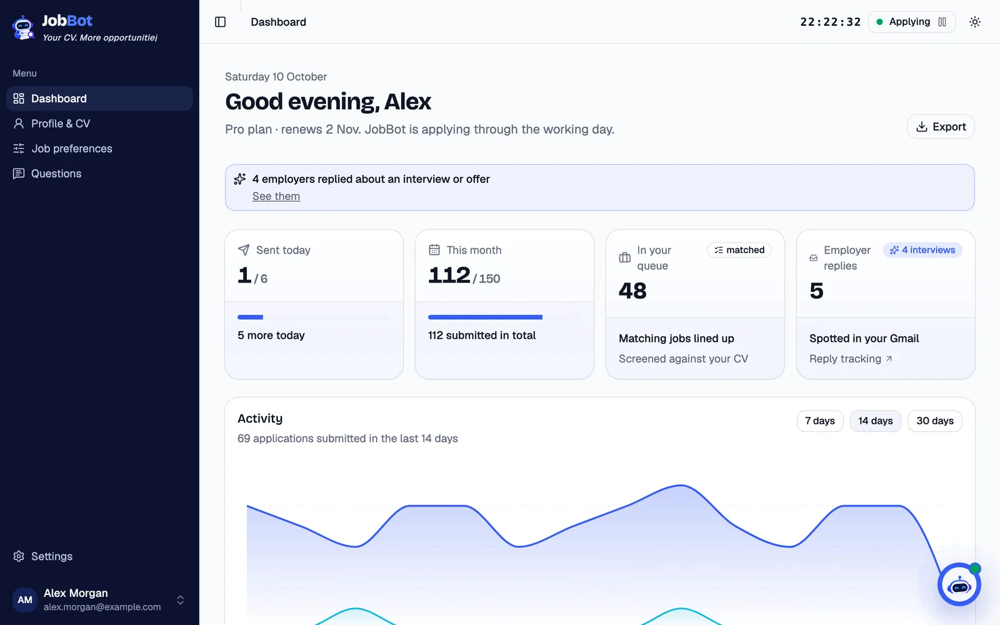
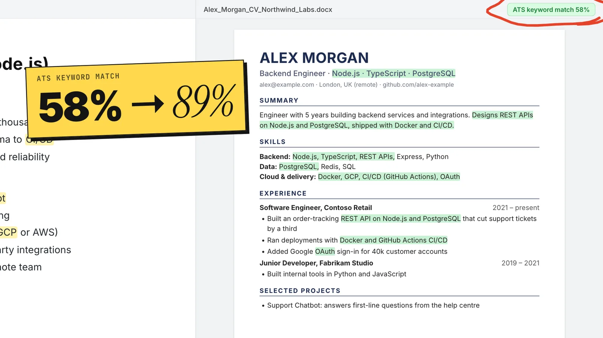
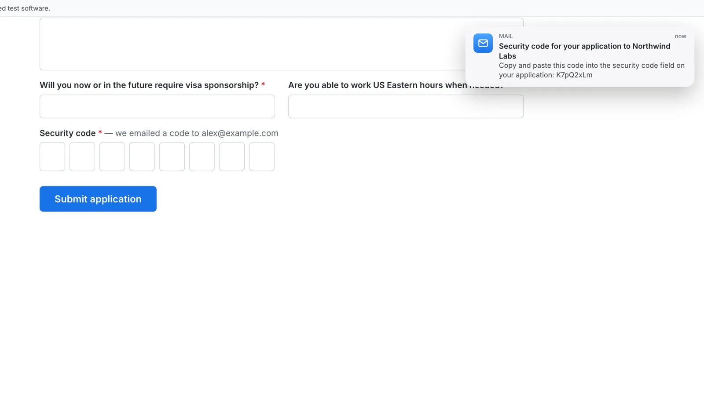
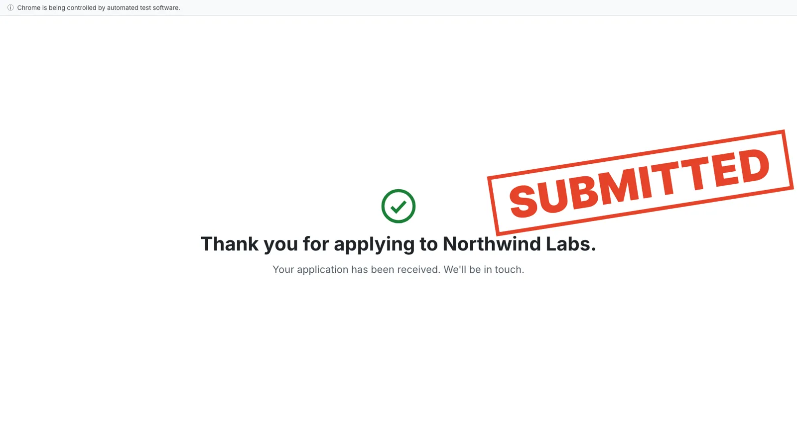
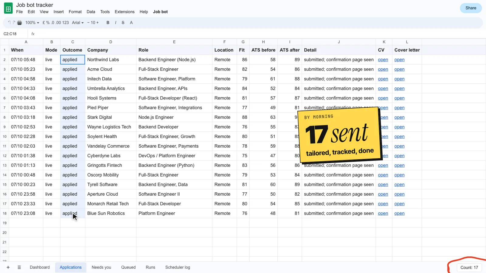
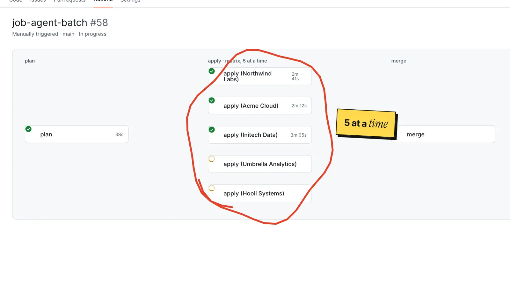
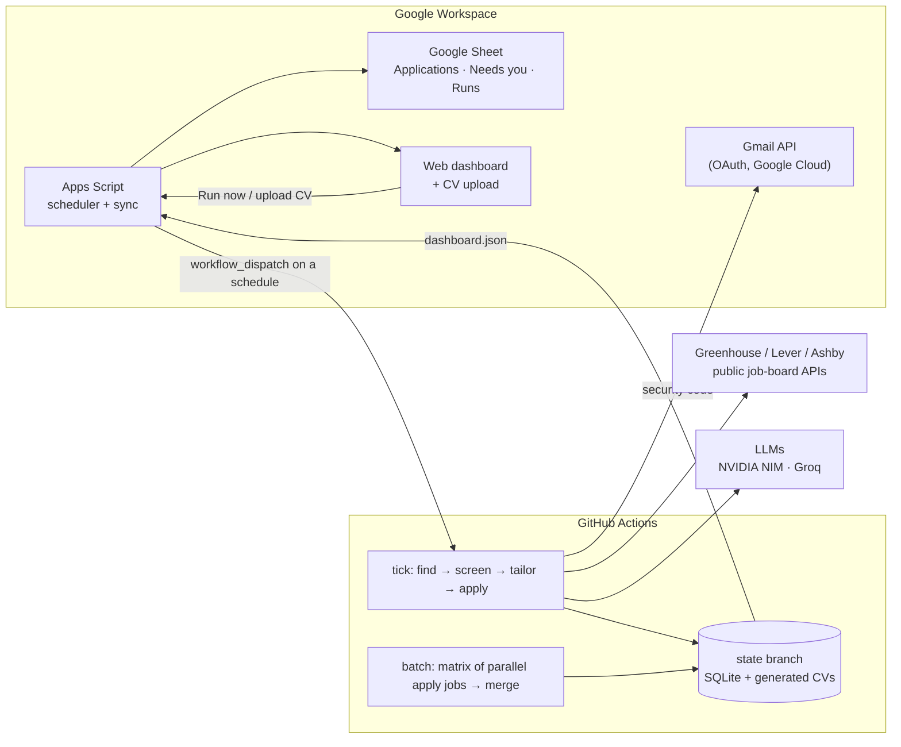

# AI Job Application Agent

An AI agent that finds remote software roles that fit a candidate, tailors the CV and cover letter to each one, fills in and submits the application, and logs every application in a Google Sheet. It runs unattended on GitHub Actions.

> **About this repository.** It documents the project: how it works, its architecture, its safeguards and a walkthrough video. The source code is private because it runs against a real CV and a real application history. To see it working, [book a demo](https://calendly.com/prateeksahni/catchup) or email hksahni0@gmail.com.

---

## The problem

Applying for remote roles means rewriting the CV and answering the same form questions for every job. Most of a job search goes on that busywork instead of the roles themselves, and generic one-size-fits-all applications rarely get past applicant-tracking systems (ATS).

## What it does

| Step | What happens |
|---|---|
| **1. Find** | Discovers companies hiring remotely through public remote-job feeds, then reads each company's own **Greenhouse, Lever or Ashby** job board through the system's public API. No scraping behind logins. |
| **2. Screen** | Applies a title and location filter, then an **LLM fit check** (is the role really remote, can the candidate be hired from where they live, a fit score from 0 to 100), then an **ATS keyword gate** that drops roles where the CV can't honestly reach a strong keyword match. |
| **3. Tailor** | Rewrites the CV in the job's own wording, using only skills and projects the candidate can prove (from the CV and the candidate's portfolio site). Every changed line is fact-checked, and the ATS score is recorded before and after. |
| **4. Write** | Writes a cover letter for that specific company, citing the candidate's most relevant projects. |
| **5. Apply** | Fills in the application form in Chrome with **Playwright**: the personal details, the CV and letter uploads, and every screening question, answered from a verified fact file. When Greenhouse emails a security code, the agent reads it through the **Gmail API** and enters it. It counts an application as submitted only when the site confirms it. |
| **6. Track** | Logs every application, with the exact CV and letter it used, in a **Google Sheet** and a web dashboard. Anything that needs a human goes on a **Needs you** list. |

## Screenshots

These use sample data: the candidate, the companies and every number are made up.

| | |
|---|---|
|  **Dashboard:** upload a Word CV and the profile rebuilds itself. |  **Tailoring:** the job's keywords, worked into real experience. |
|  **Applying:** the form filled in by the bot, plus the emailed security code. |  **Confirmed:** counted only once the site confirms the submission. |
|  **Tracking:** every application, with the CV and letter it used. |  **Under the hood:** several applications in parallel on GitHub Actions. |

## Architecture

- **Scheduling:** GitHub's own cron is unreliable for frequent jobs, so a Google Apps Script time trigger starts each run through the GitHub API (`workflow_dispatch`). It skips a slot while a run is still going.
- **Parallel runs:** a batch workflow fans the queued jobs out across a GitHub Actions matrix, then a merge job combines each worker's results into one state.
- **State:** a SQLite database and the generated documents live on a dedicated branch, force-pushed as a single commit, so the main branch stays clean.
- **Models:** a fallback chain across providers (NVIDIA NIM and Groq), with per-request token limits, so a model outage or rate limit doesn't stop a run.
- **CV upload:** a Word CV uploaded from the Sheet or the dashboard is committed through the GitHub API, and a workflow rebuilds the structured profile from it.

## Safeguards

- **No fabrication.** Answers and CV changes are checked against the candidate's verified facts. If a required question asks for something it doesn't know, the agent stops and puts the job on **Needs you**. It never guesses.
- **Human in the loop.** CAPTCHAs, bot checks, essay questions and anything it's unsure about go to a person, with the reason.
- **Paced like a person.** Applications go out during each region's working hours, under a daily cap and a per-company limit.
- **Respects the platforms.** It uses public job-board APIs and doesn't apply through LinkedIn or Indeed, which forbid automation.
- **Least privilege.** The GitHub token is fine-grained to one repository. The Gmail integration only searches for the job board's security-code emails, and deletes each one after a successful submit. Secrets live in GitHub Actions secrets and Apps Script properties.

## Tech stack

**Python** · **Playwright** · LLMs (**NVIDIA NIM**, **Groq**) · **GitHub Actions** (scheduled, matrix and merge workflows) · **Google Apps Script** · **Google Sheets** · **Gmail API** with **Google Cloud OAuth** · SQLite · python-docx and fpdf2 for the documents

## Author

**Prateek Sahni**: [prateeksahni.pages.dev](https://prateeksahni.pages.dev) · [LinkedIn](https://www.linkedin.com/in/prateek-sahni-meng) · hksahni0@gmail.com · [book a call](https://calendly.com/prateeksahni/catchup)
