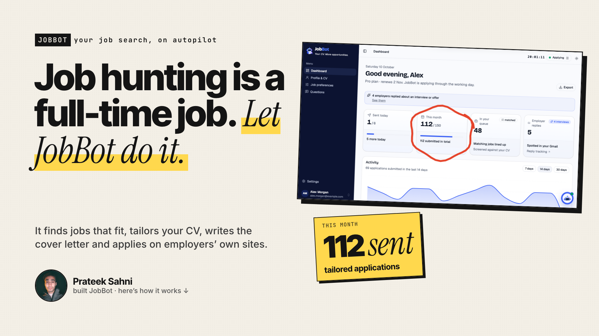
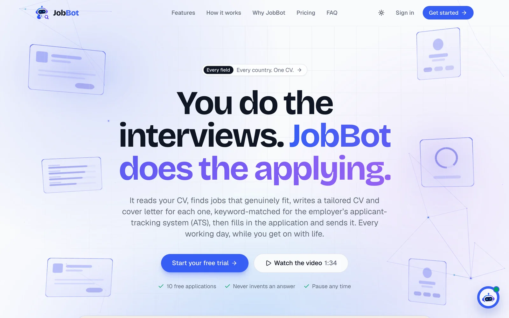
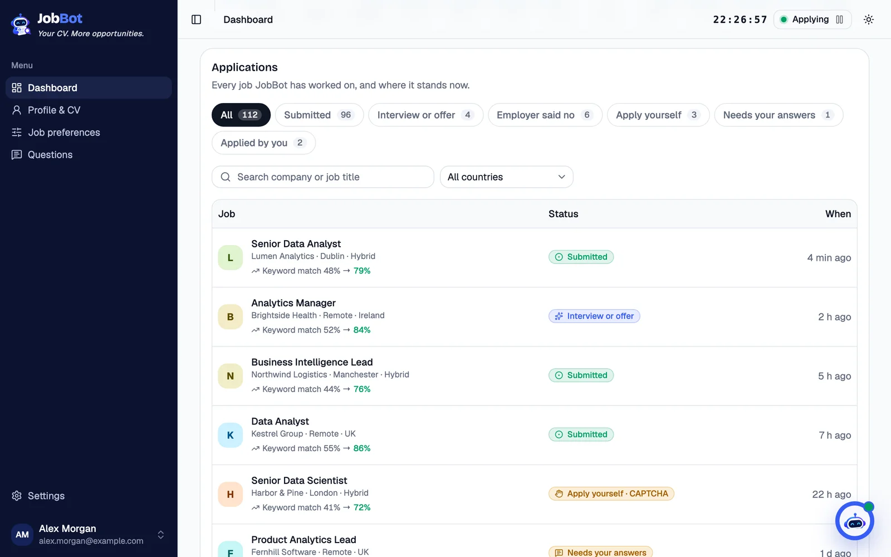
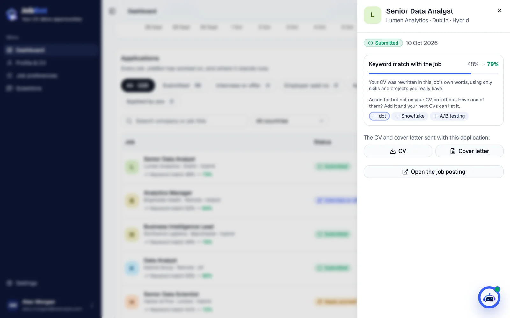
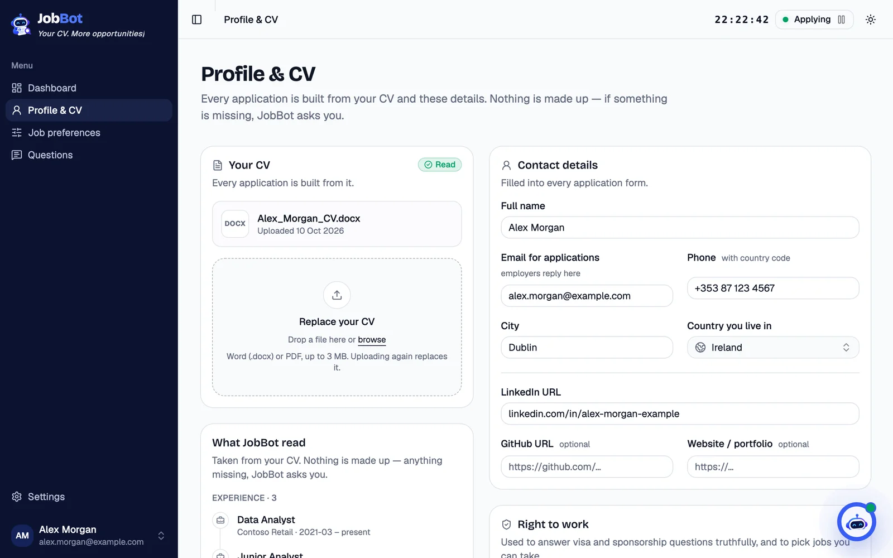
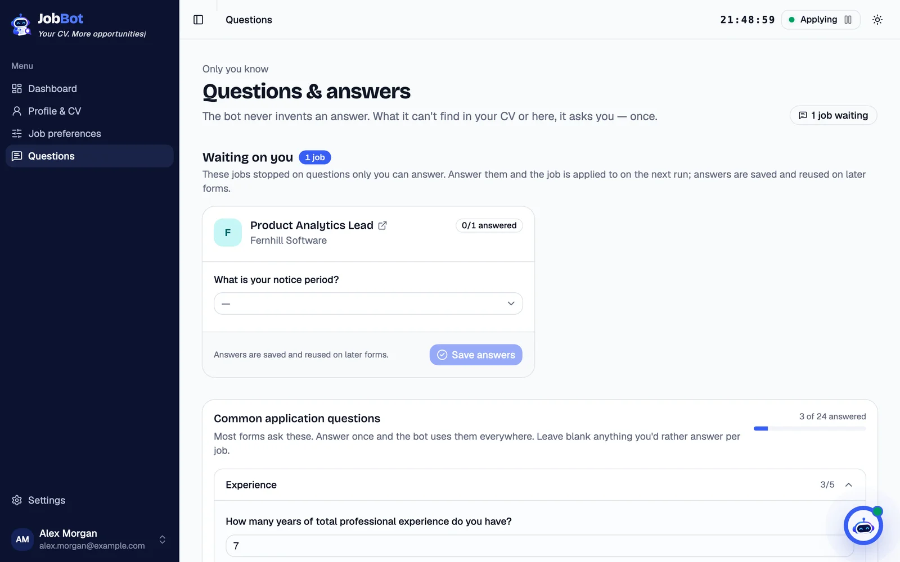
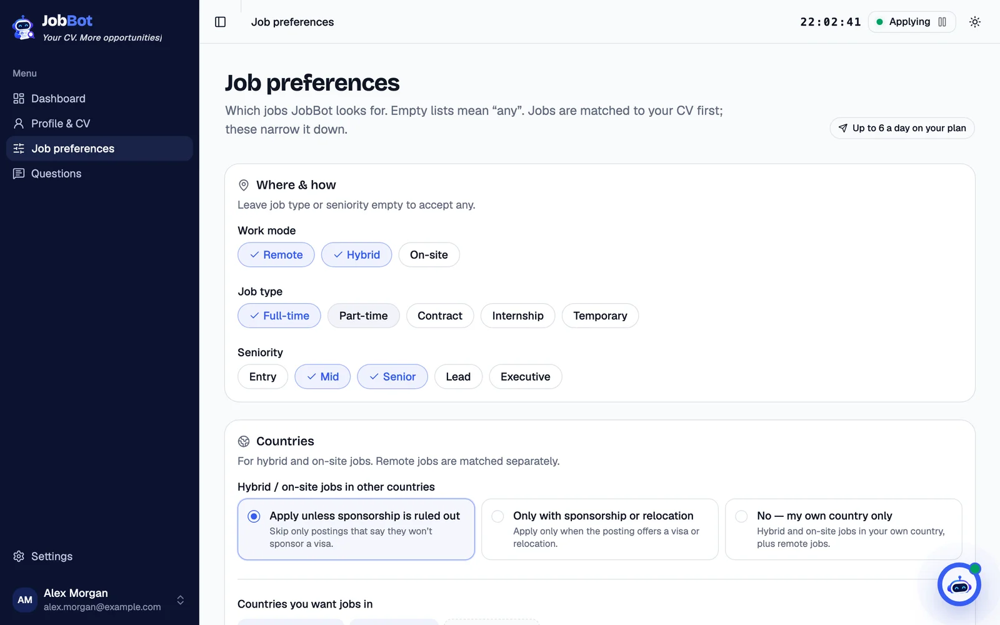
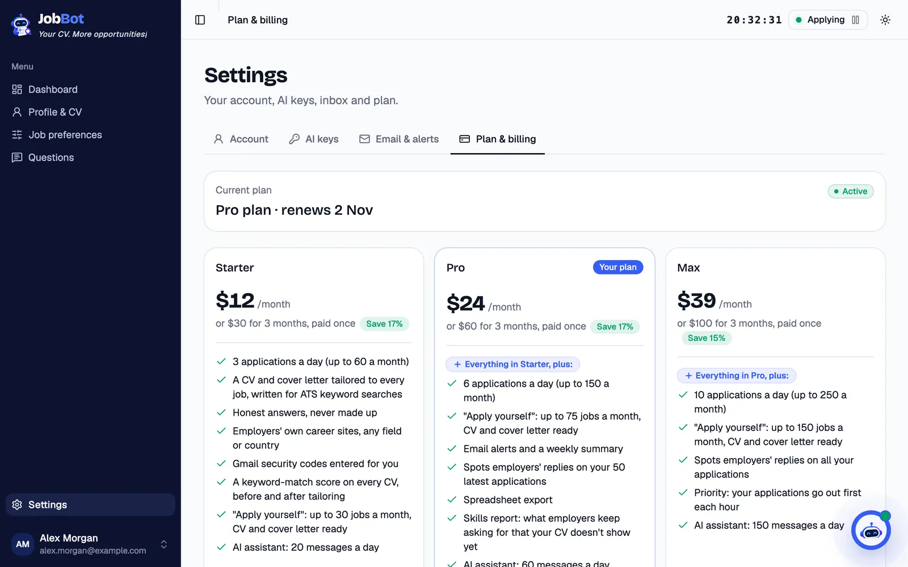
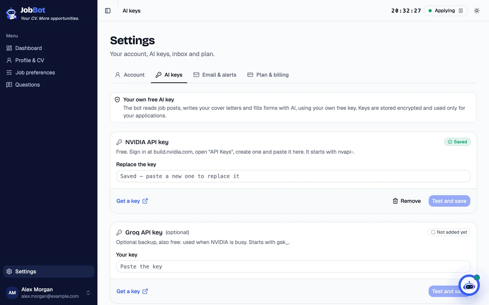
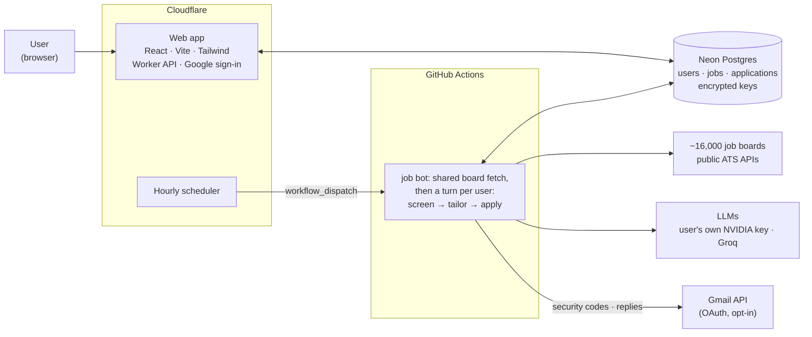

# JobBot: AI Job Application Agent

A web app that finds jobs that fit each user's CV, tailors a CV and cover letter to every one, fills in and submits the application on the employer's own site, and tracks every application. Users sign in, upload their CV once and bring their own free AI key; JobBot applies for them through the working day.

**Live at [jobbotapp.pages.dev](https://jobbotapp.pages.dev)**, with a free trial: 10 applications within 3 days, no card needed.

> **About this repository.** It documents the project: what it does, how it's built, its safeguards and a product video. The source code is private because it handles users' CVs, contact details and application histories. To see it working, [try it live](https://jobbotapp.pages.dev), [book a demo](https://calendly.com/prateeksahni/catchup) or email hksahni0@gmail.com.

---

## The problem

Job hunting is a full-time job. Rewriting the CV and answering the same form questions for every role leaves little time for the roles themselves, and generic applications rarely get past applicant-tracking systems (ATS).

## What it does

| Step | What happens |
|---|---|
| **1. Find** | Reads about **16,000 company job boards** on Greenhouse, Lever, Ashby, Workable, Recruitee, Breezy, Pinpoint and Personio through each system's free public API, and discovers new boards daily. No scraping, no logins. |
| **2. Screen** | Per user: their title, location and work-mode preferences, then an **LLM fit check** (can they be hired from where they live or in a country they can work in; a fit score from 0 to 100), then an **ATS keyword gate**. |
| **3. Tailor** | Rewrites the CV in the job's own wording, using only what the user's CV backs up. Every changed line is fact-checked, and the keyword match is shown before and after. |
| **4. Write** | Writes a cover letter for that company, citing the most relevant experience. |
| **5. Apply** | Fills in the form in Chrome with **Playwright** from the user's CV, details and saved answers. When a job site emails a security code, it reads it through the **Gmail API**. An application counts only once the site confirms it. |
| **6. Track** | One dashboard row per job, with filters, the exact CV and letter sent, and the keyword match. With Gmail connected (opt-in), employers' replies are spotted and a weekly summary lands in the inbox. Jobs it can't submit (a CAPTCHA, an account needed) wait under **Apply yourself** with their tailored CV and letter ready. |

## Screenshots

These use sample data: the user, the companies and every number are made up.

| | |
|---|---|
|  **Landing page:** a 3D background in three.js (translucent career cards, a matching network with light pulses, particles in depth), the product video, plans and FAQ. |  **Dashboard:** today's applications, the month so far, the queue and employers' replies. |
|  **Applications:** every job, its status and the keyword match before and after tailoring. |  **One application:** the match, the skills left out because the CV doesn't show them, and the CV and letter sent. |
|  **Profile & CV:** upload a CV and see what JobBot read from it. |  **Questions:** what it can't answer truthfully, it asks, once. |
|  **Preferences:** work mode, countries and job titles. |  **Plans:** Starter, Pro and Max, by applications a day. |
|  **AI keys:** each user's own free key, stored encrypted. | |

## Architecture

- **Users:** Google sign-in; a free trial of 10 applications within 3 days (5 sent automatically, 5 prepared to send yourself), then Starter, Pro or Max (3, 6 or 10 applications a day).
- **Per-user data:** CV profile, contact details and right to work, preferences, saved answers, and encrypted API keys and Gmail token. Job postings are shared; each user has their own verdicts.
- **Scheduling:** the web app's hourly cron starts the bot through the GitHub API (`workflow_dispatch`); GitHub's own cron proved unreliable.
- **Pacing:** one application per run per user, during the job's region's working hours, within the plan's daily cap and at most two per company in 30 days.
- **Models:** each user's own free NVIDIA key, with Groq as an optional backup and a fallback chain across models.
- **History:** it started as a single-user agent driven by a Google Sheet and Apps Script; the web app now schedules and manages everything.

## Safeguards

- **No fabrication.** CV changes and answers are checked against what the user's CV and saved answers back up. A question it has no facts for goes to the user's **Questions** page, and the job is applied to once they answer. It never guesses.
- **Human in the loop.** CAPTCHAs and bot checks are skipped, never bypassed; those jobs wait under **Apply yourself**.
- **Paced like a person.** Working hours, a daily cap and a per-company limit.
- **Respects the platforms.** Public job-board APIs only; it doesn't apply through LinkedIn or Indeed, which forbid automation.
- **Privacy.** Keys and Gmail access are stored encrypted. Gmail is opt-in: it reads security codes (moving each to Trash once used) and, if turned on, only the sender, subject and preview of new emails to spot employers' replies. It never sends or changes email.

## Tech stack

**Python** · **Playwright** · LLMs (**NVIDIA NIM**, **Groq**) · **React** + Vite + Tailwind CSS + shadcn/ui · **Cloudflare Workers** and Pages · **Neon Postgres** · **GitHub Actions** · **Gmail API** with **Google Cloud OAuth** · Google sign-in

## Author

**Prateek Sahni**: [prateeksahni.pages.dev](https://prateeksahni.pages.dev/projects/job-agent/) · [LinkedIn](https://www.linkedin.com/in/prateek-sahni-meng) · hksahni0@gmail.com · [book a call](https://calendly.com/prateeksahni/catchup)
